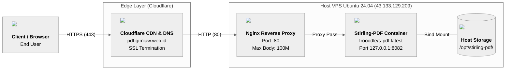

# Aplikasi Web "Stirling-PDF"

**Proyek Komunikasi Data dan Jaringan Komputer (KDJK)**
**Kelompok 7, Paralel 3**

| Nama | NIM |
| :-- | :-- |
| Yoel Christopel Napitupulu | M0403241110 |
| Valentino Pierre Rufinus Purimahua | M0403241114 |
| Rafiqi Zaldi Riyatno | M0403241116 |
| Gilang Muhamad Widiagung | M0403241117 |

Situs yang berjalan: [https://pdf.gimiaw.web.id/](https://pdf.gimiaw.web.id/)

## Sekilas Tentang

Deskripsi singkat tentang aplikasi tsb.


## Instalasi

### Arsitektur Deployment & Diagram Jaringan

Aplikasi dideploy menggunakan arsitektur 3 lapis untuk efisiensi, keamanan, dan kemudahan akses:



1. **Cloudflare (Edge/DNS & SSL/TLS)**: Menangani manajemen domain `gimiaw.web.id`, proxy CDN, perlindungan DDoS, dan terminasi SSL/TLS (HTTPS) secara gratis tanpa perlu setup certbot manual di server.
2. **Nginx (Host Reverse Proxy)**: Menerima trafik HTTP (port 80) dari Cloudflare, meneruskan request ke port lokal container, serta mengatur batas ukuran payload unggahan (`client_max_body_size`) dan timeout pemrosesan.
3. **Docker Engine & Compose (Container Runtime)**: Mengisolasi aplikasi Stirling-PDF beserta dependensinya (Java runtime, LibreOffice headless, dan daemon unoserver) di lingkungan kontainer terisolasi yang di-bind ke loopback interface host (`127.0.0.1:8082`).

### Prasyarat
- **Server/VPS**: Ubuntu 24.04 LTS (RAM 2 GB, CPU 1-2 vCPU, Disk sisa minimal 10 GB)
- **Akses**: Root / Sudo melalui SSH
- **Software**: Docker Engine, Docker Compose Plugin, Nginx Web Server
- **Akun & Domain**: Domain aktif di Cloudflare (`gimiaw.web.id`)

### Langkah Instalasi

#### 1. Setup DNS & SSL di Cloudflare
1. Masuk ke dashboard Cloudflare dan buka menu domain `gimiaw.web.id`.
2. Masuk ke tab **DNS** > **Records**, lalu tambahkan A Record baru:
   - **Type**: `A`
   - **Name**: `pdf`
   - **IPv4 Address**: `<IP_PUBLIC_VPS>` (misal: `43.133.129.209`)
   - **Proxy Status**: `Proxied` (awan oranye aktif untuk enkripsi otomatis dan proteksi IP)
3. Masuk ke tab **SSL/TLS** > **Overview**, pastikan enkripsi diatur ke mode **Flexible** (koneksi klien ke Cloudflare terenkripsi HTTPS, koneksi Cloudflare ke VPS via port 80 HTTP).

#### 2. Persiapan Server & Instalasi Docker + Nginx
Jalankan di terminal VPS:
```bash
# Update sistem dan install dependencies
apt update && apt upgrade -y
apt install -y docker.io docker-compose-v2 nginx curl
systemctl enable --now docker nginx
```

#### 3. Setup Struktur Direktori & Persistensi
```bash
mkdir -p /opt/stirling-pdf/trainingData \
         /opt/stirling-pdf/extraConfigs \
         /opt/stirling-pdf/customFiles \
         /opt/stirling-pdf/logs
cd /opt/stirling-pdf
```

#### 4. Pembuatan File `docker-compose.yml`
```bash
cat << 'EOF' > /opt/stirling-pdf/docker-compose.yml
services:
  stirling-pdf:
    image: frooodle/s-pdf:latest
    container_name: stirling-pdf
    ports:
      - '127.0.0.1:8082:8080'
    volumes:
      - ./trainingData:/usr/share/tessdata
      - ./extraConfigs:/configs
      - ./customFiles:/customFiles
      - ./logs:/logs
    environment:
      - DOCKER_ENABLE_SECURITY=false
      - INSTALL_BOOK_AND_ADVANCED_HTML_OPS=false
      - LANGS=en_GB
    restart: unless-stopped
EOF
```
*Catatan Port: Port aplikasi dalam container (`8080`) diekspos hanya ke loopback lokal host (`127.0.0.1:8082`). Ini mencegah akses langsung dari luar tanpa melewati Nginx proxy.*

#### 5. Menjalankan Container
```bash
cd /opt/stirling-pdf
docker compose up -d
```

---

## Konfigurasi

### 1. Reverse Proxy Nginx & Penyesuaian Upload Limit
Agar aplikasi dapat diakses via subdomain `pdf.gimiaw.web.id` dan mampu mengolah berkas PDF berukuran besar, konfigurasi Nginx diterapkan dengan batas body request hingga 100 MB:

```bash
cat << 'EOF' > /etc/nginx/sites-available/pdf.gimiaw.web.id
server {
    listen 80;
    server_name pdf.gimiaw.web.id;

    # Batas ukuran upload dokumen PDF
    client_max_body_size 100M;

    location / {
        proxy_pass http://127.0.0.1:8082;
        proxy_set_header Host $host;
        proxy_set_header X-Real-IP $remote_addr;
        proxy_set_header X-Forwarded-For $proxy_add_x_forwarded_for;
        proxy_set_header X-Forwarded-Proto $scheme;

        # Timeout dinaikkan agar konversi/OCR dokumen besar tidak putus
        proxy_read_timeout 300s;
        proxy_connect_timeout 300s;
    }
}
EOF

# Aktifkan konfigurasi dan reload service Nginx
ln -sf /etc/nginx/sites-available/pdf.gimiaw.web.id /etc/nginx/sites-enabled/
nginx -t && systemctl reload nginx
```

### 2. Konfigurasi Autentikasi (Akses Publik Tanpa Login)
Secara default pada versi terbaru (v3+), Stirling-PDF mewajibkan setup password admin saat pertama kali dijalankan. Untuk akses langsung tanpa sistem akun:

```bash
sed -i 's/enableLogin: true/enableLogin: false/g' /opt/stirling-pdf/extraConfigs/settings.yml
cd /opt/stirling-pdf && docker compose restart
```

### 3. Konfigurasi Dukungan Konversi Dokumen Office (DOCX, PPTX, Excel)
Untuk menjalankan konversi dokumen office ⇄ PDF, digunakan image varian standar (`frooodle/s-pdf:latest`) yang sudah memuat paket LibreOffice headless dan unoserver daemon. Dukungan ini memakan alokasi swap saat konversi berjalan di VPS 2 GB RAM.


##  Maintenance (opsional)

Setting tambahan untuk maintenance secara periodik, misalnya:
- buat backup database tiap pekan
- hapus direktori sampah tiap hari
- dll


## Otomatisasi (opsional)

Skrip shell untuk otomatisasi instalasi, konfigurasi, dan maintenance.

## Cara Pemakaian

- Tampilan aplikasi web
- Fungsi-fungsi utama
- Isi dengan data real/dummy (jangan kosongan) dan sertakan beberapa screenshot

# Pembahasan
 
## Kelebihan
 
- **Gratis dan semua tool PDF dapat dipakai.** Menurut dokumentasi resmi, paket Free sudah mencakup seluruh tool PDF dan REST API. Paket berbayar hanya menambah fitur untuk skala organisasi, seperti SAML SSO, audit log, dan database eksternal.
- **Data tetap di server sendiri.** Dokumen tidak diunggah ke layanan pihak ketiga, sehingga cocok untuk dokumen yang sensitif.
- **Tidak ada kuota tugas harian; batas ukuran mengikuti konfigurasi server.** Berbeda dengan layanan online gratis seperti iLovePDF.
- **Fitur lengkap.** Ada 50+ operasi PDF, antara lain *merge*, *split*, kompresi, konversi dari/ke format Office, OCR, tanda tangan, dan *redact*.
- **Pemasangan relatif mudah.** Cukup satu *container* Docker tanpa database eksternal, dan komunitasnya besar (sekitar 89 ribu *stars* di GitHub) sehingga panduan mudah ditemukan.

## Kekurangan
 
- **Harus dikelola sendiri.** Pemasangan, pembaruan, *backup*, dan keamanan server menjadi tanggung jawab kita.
- **Cukup berat untuk server kecil.** Aplikasinya berbasis Java sehingga membutuhkan sekitar 1-2 GB RAM atau lebih, dan varian *fat* (dengan LibreOffice dan OCR) disarankan minimal 2 GB.
- **Ada batas 5 akun pada paket Free.** Batas ini berlaku bila menggunakan mode multi-user.
- **Keamanan perlu diatur.** Pada beberapa panduan, instalasi awal berjalan tanpa login dan memakai kredensial bawaan, sehingga perlu diamankan sebelum dibuka ke internet.
- **Hanya untuk PDF.** Kebutuhan gambar, video, atau audio memerlukan aplikasi lain.
 
## Perbandingan dengan Aplikasi Sejenis
 
| Aspek | Stirling-PDF | SnapOtter | iLovePDF |
|---|---|---|---|
| **Jenis layanan** | *Self-hosted* | *Self-hosted* | Layanan web (online) |
| **Cakupan** | Khusus PDF | Gambar, video, audio, PDF, dan file umum | Khusus PDF |
| **Privasi data** | File diproses di server sendiri | File diproses di server sendiri | File diunggah ke server iLovePDF dan dihapus otomatis setelah beberapa jam |
| **Biaya** | Gratis; biaya hanya server. Ada paket berbayar untuk tim besar | Gratis (AGPLv3); biaya hanya server | Gratis dengan batasan; *Premium* berbayar |
| **Batasan** | Tanpa login, tidak ada batas pengguna; 5 akun jika login bawaan diaktifkan | Tergantung server | Dibatasi jumlah tugas dan ukuran file di paket gratis |
| **Kebutuhan server** | Sekitar 1-2 GB RAM | Minimal 1 GB RAM dan 5 GB disk | Tidak perlu server |
| **Komunitas** | Sangat besar (± 89 ribu *stars*) | Masih kecil (± 2,2 ribu *stars*), proyek baru | Layanan komersial mapan |
| **Kemudahan** | Perlu setup awal | Perlu setup awal | Paling mudah, langsung buka browser |
 
## Kesimpulan
 
- **Stirling-PDF cocok jika** kita ingin mengolah PDF tanpa batas dengan data tetap di server sendiri dan ada server yang bisa dikelola. **Tetapi jika** tidak ada server atau tidak ingin repot merawatnya, iLovePDF lebih praktis dengan konsekuensi file diunggah ke pihak ketiga dan ada batasan pemakaian.
- **Stirling-PDF lebih baik daripada SnapOtter jika** fokusnya hanya PDF dan kita ingin aplikasi yang matang dengan komunitas besar. **Tetapi jika** kita butuh satu platform untuk banyak jenis file (gambar, video, audio), SnapOtter lebih sesuai.

## Referensi
 
1. https://github.com/Stirling-Tools/Stirling-PDF
2. https://docs.stirlingpdf.com/Server/Licensing/Plans-and-Licences/
3. https://docs.stirlingpdf.com/Modes%20and%20Licensing
4. https://railway.com/deploy/stirling
5. https://hub.docker.com/r/snapotter/snapotter
6. https://dinao.com/conteneur/snapotter
7. https://www.opentechhub.io/snapotter/
8. https://www.switchlabs.dev/compare/pdf-to-word-vs-ilovepdf
9. https://us.fitgap.com/products/ilovepdf
10. https://dev.to/vikasprogrammer/self-hosting-stirling-pdf-in-2026-i-ditched-adobe-and-smallpdf-1pd9
